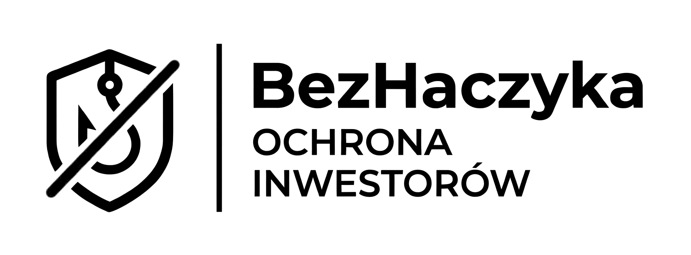

<p align="center"></p>

<h1 align="center">Zadanie InvestWatch – BezHaczyka</h1>

System monitoringu reklam usług inwestycyjnych w internecie, przygotowany na wyzwanie UKNF
(HackNation 2026). Zbiera materiały z Facebooka i Instagrama (Meta Ad Library), TikToka,
YouTube i stron WWW, dopasowuje je do rejestru firm inwestycyjnych KNF i ocenia lokalnym modelem
Bielik. Wyniki trafiają do panelu nadzorcy z alertami na żywo.

- **Moduł 1** – reklamy firm z rejestru KNF publikowane przez podmioty trzecie i finfluencerów.
- **Moduł 2** – zgodność informacji o ryzyku z art. 44 rozporządzenia 2017/565 (18 reguł).
- **Moduł 3** – oferty doradztwa inwestycyjnego bez zezwolenia (shadow advisory).

Całość działa on-premise, wyłącznie na otwartym oprogramowaniu i otwartych modelach.

## Uruchomienie

```
cd infra
cp .env.example .env
docker compose up -d --build
```

Pierwszy start pobiera modele (ok. 6 GB) i buduje obrazy, co trwa 10–15 minut. Kolejne starty zajmują
około minuty. Harmonogram sam uruchamia zbieranie; jeden przebieg na żądanie:

```
docker compose exec scheduler python -m scheduler --once
```

| Adres | Co |
|---|---|
| http://localhost:7090 | panel nadzorcy |
| http://localhost:8000/docs | API (FastAPI) |
| http://localhost:8080 | strony demonstracyjne (tryb offline) |

Stan serwisów: `docker compose ps`, logi: `docker compose logs -f <serwis>`.

## Wymagania sprzętowe

| Zasób | Zalecane | Minimum |
|---|---|---|
| GPU | NVIDIA, 8 GB VRAM | brak (tryb CPU, analiza kilkukrotnie wolniejsza) |
| RAM | 16 GB | 12 GB |
| CPU | 8 rdzeni | 4 rdzenie |
| Dysk | 20 GB wolnego miejsca | – |
| System | Docker Desktop z WSL2 (Windows) albo Docker Engine (Linux), Compose 2.24+ | – |

Na Windows Docker domyślnie dostaje tylko połowę pamięci RAM, czego przy 16 GB nie wystarcza.
Przed pierwszym startem utwórz plik `%USERPROFILE%\.wslconfig` i zrestartuj Docker Desktop:

```
[wsl2]
memory=12GB
swap=8GB
```

Bez karty NVIDIA dopisz w `infra/.env`:
`COMPOSE_FILE=docker-compose.yml:docker-compose.cpu.yml`.
Instalacja Dockera na Windows: [docs/INSTALACJA-WINDOWS.md](docs/INSTALACJA-WINDOWS.md).

## Konfiguracja serwisów

Wszystkie ustawienia są w `infra/.env` (opisane w [infra/.env.example](infra/.env.example)).
Hasła i klucze trzymamy tylko tam.

| Serwis | Rola | Najważniejsze ustawienia |
|---|---|---|
| `scheduler` | harmonogram zbierania i ponownych sprawdzeń | `services/scraper/schedule.yaml` |
| `scraper-worker`, `scraper-worker-render` | wyszukiwanie i pobieranie materiałów (Playwright, httpx), rotacja User-Agent i proxy | `SCRAPER_*`, `FB_*`, `YT_*`, `TIKTOK_MODE`, `SCRAPER_PROXIES` |
| `analyzer` | ocena materiałów: zakres, reguły, scoring | `OLLAMA_*`, `LLM_*` |
| `autoscaler` | dokłada kontenery analizy przy kolejce (limity ustawia panel operatora) | `ANALYZER_MAX_REPLICAS`, `ANALYZER_EXTRA_*` |
| `ollama`, `ollama-pull` | model Bielik 4.5B i bge-m3, pobierane automatycznie | `OLLAMA_NUM_PARALLEL`, `OLLAMA_MODELS_PULL` |
| `api` | REST i WebSocket dla panelu | `API_PORT`, `ALERT_*` |
| `web` | panel nadzorcy (React, Recharts) | `WEB_PORT` |
| `postgres` | metadane, wyniki analizy (PostgreSQL 16 + pgvector) | `POSTGRES_*` |
| `seaweedfs` | magazyn treści: HTML, zrzuty, wideo (S3) | `S3_*` |
| `valkey` | kolejki zadań (RQ) | – |
| `casedb` | migracje bazy i rejestr KNF (start jednorazowy) | – |

Limity CPU i pamięci każdego serwisu ustawia się zmiennymi `*_CPUS` i `*_MEM`.

## Dokumentacja

- [Architektura i przepływ danych](docs/MODUL1-ARCHITEKTURA.md)
- [18 reguł oceny i sposób ich sprawdzania](docs/REGULY.md)
- [Jak pracowaliśmy z asystentami AI](docs/AI_PROCESS.md)
- [Licencje](docs/LICENSES.md) i [audyt zależności](docs/SECURITY-AUDIT.md)
- [Po pobraniu zmian z repozytorium](docs/PO-AKTUALIZACJI.md)

Zgodność z wymogami konkursu (on-premise, licencje, sekrety, przypięte wersje):
`python tools/check_compliance.py`. Skan podatności: `sh tools/audit.sh`.
