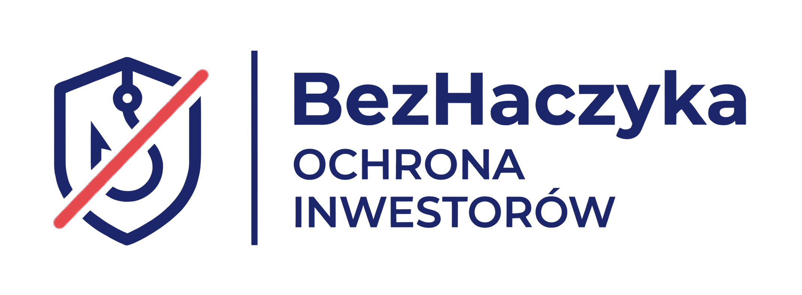

<p align="center"></p>

<h1 align="center">Zadanie InvestWatch – BezHaczyka</h1>

System monitoringu reklam usług inwestycyjnych dla UKNF. Zbiera materiały z Facebooka i Instagrama
(Meta Ad Library), TikToka, YouTube i stron WWW, dopasowuje je do rejestru KNF i ocenia lokalnym modelem
Bielik: reklamy firm u podmiotów trzecich (Moduł 1), informację o ryzyku wg 18 reguł art. 44 (Moduł 2)
i doradztwo bez zezwolenia (Moduł 3). Działa on-premise, na otwartym oprogramowaniu.

## Uruchomienie

```
cd infra && cp .env.example .env && docker compose up -d --build
```

Pierwszy start pobiera modele i buduje obrazy (10–15 min). Panel: http://127.0.0.1:37090/#/,
API: http://localhost:8000/docs. Zbieranie na żądanie: `docker compose exec scheduler python -m scheduler --once`.
Gotowe dane z 20-minutowego testu do wgrania: [demo/README.md](demo/README.md).

## Wymagania sprzętowe

| GPU | RAM | CPU | Dysk |
|---|---|---|---|
| NVIDIA 8 GB VRAM (bez GPU: tryb CPU, wolniej) | 16 GB | 8 rdzeni | 20 GB (modele ok. 7 GB) |

Docker Desktop z WSL2 lub Docker Engine, Compose 2.24+. Na Windows przydziel Dockerowi więcej pamięci
w `%USERPROFILE%\.wslconfig` (`[wsl2]`, `memory=12GB`, `swap=8GB`) i zrestartuj Docker Desktop.
Bez NVIDIA dopisz w `infra/.env`: `COMPOSE_FILE=docker-compose.yml:docker-compose.cpu.yml`.

## Konfiguracja serwisów

Ustawienia są w `infra/.env` (opisane w [infra/.env.example](infra/.env.example)), sekrety tylko tam.
Serwisy: `scheduler` i `scraper-worker*` (zbieranie: Playwright, httpx, rotacja User-Agent i proxy),
`analyzer` i `autoscaler` (ocena modelem, skalowanie kontenerów), `ollama` (Bielik 4.5B, bge-m3),
`api` i `web` (REST, WebSocket, panel), `postgres`, `seaweedfs`, `valkey` (dane, pliki, kolejki).
Szczegóły i tabela ustawień: [infra/README.md](infra/README.md).

## Dokumentacja

[18 reguł oceny](docs/REGULY.md) · [architektura](docs/MODUL1-ARCHITEKTURA.md) ·
[proces z asystentami AI](docs/AI_PROCESS.md) · [licencje](docs/LICENSES.md) ·
[audyt zależności](docs/SECURITY-AUDIT.md) · [instalacja na Windows](docs/INSTALACJA-WINDOWS.md)

Zgodność z wymogami (on-premise, licencje, sekrety, wersje): `python tools/check_compliance.py`.
Licencja: MIT.
